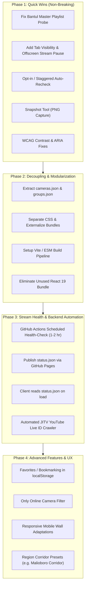

# Jogja CCTV Viewer — Comprehensive Audit & Consideration Plan

> **Date**: 3 November 2026  
> **Target**: `jogja-cctv-viewer` (`index.html`)  
> **Scope**: Architecture, Stream Reliability, Performance, Security, Accessibility, and Product Roadmap  

---

## 1. Executive Summary

**Jogja CCTV Viewer** is a real-time web application monitoring 468 public CCTV cameras across the Yogyakarta Special Region (DIY), Indonesia. It aggregates streams from:
1. **Pemda DIY Portal** (`cctv.jogjaprov.go.id` — 433 streams via HLS)
2. **Bantul Regency Portal** (`stream.bantulkab.go.id` — 31 streams via HLS)
3. **JITV Pemda DIY** (`youtube.com` — 4 live streams via YouTube embeds)

The application currently lives as a single, self-contained **2.53 MB monolithic HTML file** (`index.html`) containing inline CSS, HTML markup, embedded base64 libraries (HatchMaps/MapLibre, React 19 runtime, MapHelpers, Hls.js), and 875 lines of custom application JavaScript.

While the app features strong UX concepts (exponential backoff player revival, browser-based video recording, map integration, and responsive video walls), the audit identifies critical bottlenecks in **performance, government server load, stream parsing bugs, accessibility compliance, and monolithic maintainability**.

---

## 2. Technical Audit Findings

### 2.1 Architecture & Asset Packaging

| Issue | Severity | Detail | Impact |
|---|---|---|---|
| **Monolithic 2.53 MB File** | **High** | The entire application, styles, 468 camera records, and 3 base64 JavaScript bundles (HatchMaps, MapHelpers, Hls.js) are packed into one HTML file. | Prevents browser HTTP caching of dependencies; every refresh requires re-downloading and re-parsing 2.5 MB of base64 text. |
| **Deadweight React 19 Bundle** | **Medium** | `HatchMaps` includes a minified React 19.3.0 and Scheduler runtime (~150 KB+ uncompressed), yet the app itself is written in imperative vanilla JavaScript (`document.querySelector`, `innerHTML`). | Unnecessary memory overhead and parsing delays on mobile devices. |
| **Data & Code Tight Coupling** | **Medium** | The 468 camera dataset (`var CAMS = [...]`) is hardcoded directly into the JavaScript block in `index.html`. | Any camera URL change, offline status tweak, or coordinate fix requires committing changes to a 2.5 MB code file. |

---

### 2.2 Performance & Network Hazards

| Issue | Severity | Detail | Impact |
|---|---|---|---|
| **High Concurrency Startup Recheck (~936 HTTP Requests)** | **Critical** | 2.5s after page load, `runRecheck(true)` spawns 6 concurrent workers testing all 468 cameras. Each test requests the `.m3u8` playlist AND the newest `.ts` chunk (`Range: bytes=0-1023`). | Floods `cctv.jogjaprov.go.id` with nearly 1,000 rapid requests per visitor. This risks IP rate-limiting, 503 gateway timeouts, or unintentional DDoS on municipal infrastructure. |
| **Unbounded Video Wall Resource Consumption** | **High** | The 3×3 (9 tiles) and 4×4 (16 tiles) video walls decode HD live streams simultaneously in a single tab without an `IntersectionObserver` or visibility gate. | Extreme CPU/GPU hardware decoder usage; rapidly drains battery and causes tab crashes on mobile devices or lower-tier laptops. Streams continue decoding even when scrolled out of view or tab is backgrounded. |
| **Long Probe Timeouts (14 seconds)** | **Medium** | `probeOnce()` uses a 14-second AbortController timeout. If origins flap or throttle, probing 468 streams can take several minutes to complete. | Delayed UI updates and prolonged background network activity. |

---

### 2.3 Stream Protocols & Playback Bugs

| Issue | Severity | Detail | Impact |
|---|---|---|---|
| **Bantul Master Playlist Parsing Flaw** | **High** | `probeOnce()` expects `.m3u8` to contain `.ts` chunks directly. However, Bantul streams (`stream.bantulkab.go.id`) return an HLS **Master Playlist** (`#EXT-X-STREAM-INF`) pointing to sub-playlists (`..._output_0.m3u8?session=...`). | The probe treats the sub-playlist line as a video segment and requests `bytes=0-1023`. While the server responds with 200, the probe never validates actual video chunk availability. |
| **Ephemeral YouTube Live IDs** | **Medium** | The 4 JITV live streams use static video IDs (`bon52B5XhhI`, etc.). While currently active, YouTube 24/7 lives generate new IDs when streams restart or disconnect. | Stale video IDs permanently break YouTube tiles until manually edited in code. |
| **Safari / Native HLS Edge Cases** | **Low** | On iOS/Safari where `Hls.isSupported()` is false, native HLS is used. Native `<video>` error events trigger `revive()`, but native error recovery does not reset the live edge as cleanly as Hls.js `recoverMediaError()`. | Occasional frozen frames on mobile Safari after minor network drops. |

---

### 2.4 Security & Privacy

| Area | Status | Assessment |
|---|---|---|
| **Content Security Policy (CSP)** | ⚠️ Missing | No CSP meta tag or header defined. Embedding base64 data URIs and inline scripts makes adding strict CSP harder unless modernized. |
| **CORS Dependency** | ⚠️ Fragile | Both `cctv.jogjaprov.go.id` and `stream.bantulkab.go.id` currently return `Access-Control-Allow-Origin: *`. If municipal administrators restrict CORS headers, all browser-direct HLS requests will fail. |
| **DOM Sanitization** | ✅ Secure | User search queries in `#q` are matched against strings in memory and toggle CSS display; input is not injected into `innerHTML`. String escaping (`esc()`) is applied to camera names. |
| **Client-Side Recording** | ✅ Privacy-Respecting | Video recording strips audio tracks (`stream.removeTrack(t)`) and generates local browser Blobs (`URL.createObjectURL`). Zero video data is uploaded to external servers. |

---

### 2.5 Accessibility (a11y) & UX

| Aspect | Issue | WCAG / UX Guideline |
|---|---|---|
| **Color Contrast (Light Mode)** | `--accent: #b97a08` on white background yields **3.59:1**, falling below the **4.5:1** requirement for standard text. (Dark mode `#ffb224` passes at 9.88:1). | WCAG 2.1 AA §1.4.3 |
| **Search Field Labeling** | `<label class="search">` wraps the input and an SVG icon with no text or `aria-label`. | WCAG 2.1 A §1.3.1 / §4.1.2 |
| **Wall Segmented Controls** | Grid size buttons (`2x2`, `3x3`, `4x4`) and fullscreen column selectors lack `aria-pressed="true|false"`. | WAI-ARIA Toggle Button Pattern |
| **Live Announcements** | Recheck progress updates (`Stop · 45/468 checked`) lack `aria-live="polite"`. | WCAG 2.1 AA §4.1.3 |
| **Mobile Grid Density** | 3×3 grid on viewports < 640px shrinks tiles to ~100px wide, rendering video unviewable and UI buttons untappable. | Mobile Usability (Min 44×44px touch target) |

---

## 3. Consideration Plan & Strategic Roadmap

The recommended plan is structured into **four progressive phases**, balancing immediate stability with long-term maintainability.



---

### Phase 1: Quick Wins & Immediate Polish (Zero Breaking Changes)

*Target: Can be applied directly inside `index.html` without changing architecture.*

1. **Smart Stream Probing (Fix Master Playlist Bug)**:
   - Enhance `probeOnce()` to inspect playlist text. If `#EXT-X-STREAM-INF` is detected, resolve the target sub-playlist before fetching the media segment.
   - Reduce timeout from 14s to 6s per probe to prevent queue starvation.

2. **Resource-Throttling via Visibility & Intersection Observers**:
   - Pause or detach HLS players in wall tiles when `document.hidden` is true (user switches tabs).
   - Use `IntersectionObserver` on `.tile` elements so tiles scrolled out of viewport pause decoding and resume when scrolled back into view.

3. **Conservative Auto-Recheck**:
   - Instead of probing all 468 cameras on startup, only verify cameras currently on stage or in the active wall.
   - Leave the global recheck to be triggered manually via the "Recheck streams" button, or batch it in small chunks of 20 with idle pauses.

4. **Instant Snapshot Button**:
   - Add a "Snapshot" camera button next to "Record".
   - Use `<canvas>.drawImage(video)` to export a crisp full-resolution `.png` or `.jpg` instantly without requiring a MediaRecorder session.

5. **Accessibility Adjustments**:
   - Change light mode `--accent` text to `--accent-ink: #8a5c00` (5.81:1 contrast ratio, passing WCAG AA).
   - Add `aria-label="Search cameras"` to `#q`.
   - Add `aria-pressed` attributes to segmented control buttons.

---

### Phase 2: Architecture Decoupling & Build Modernization

*Target: Transform from an unwieldy 2.5 MB single file into a standard, clean modern web repository.*

1. **Repository Structure**:
   ```
   jogja-cctv-viewer/
   ├── public/
   │   └── favicon.ico
   ├── src/
   │   ├── data/
   │   │   ├── cameras.json      # 468 cameras with coordinates, stream URLs, group IDs
   │   │   └── groups.json       # 10 administrative camera groups & badge colors
   │   ├── styles/
   │   │   ├── variables.css     # Theming, colors, light/dark mode variables
   │   │   ├── layout.css        # Topbar, grid, responsive layout
   │   │   └── components.css    # Stage, wall tiles, camera list, map
   │   ├── modules/
   │   │   ├── player.ts         # Hls.js abstraction, backoff revival, cleanup
   │   │   ├── recorder.ts       # MediaRecorder video capture & snapshot export
   │   │   ├── checker.ts        # Stream health probing & status tracking
   │   │   ├── wall.ts           # Video wall state, grid reshaping, fullscreen
   │   │   └── map.ts            # MapLibre GL pin rendering & provider switching
   │   ├── main.ts               # App initialization & event wiring
   │   └── index.html            # Clean, lightweight HTML template (< 10 KB)
   ├── package.json              # Vite, TypeScript, ESLint, Prettier
   └── tsconfig.json
   ```

2. **Bundle Optimization**:
   - Replace the internal `HatchMaps` bundle with direct, official `maplibre-gl` npm package or ESM import.
   - Completely remove the unused React 19 runtime.
   - Benefit: Code size drops from 2.5 MB to ~180 KB gzipped, and static assets get cached permanently in browsers.

---

### Phase 3: Centralized Stream Health & Monitoring

*Target: Shift stream health verification from individual clients to an automated serverless cron job.*

1. **GitHub Actions Health-Check Cron**:
   - Run a scheduled workflow (e.g., every 60–120 minutes) via a lightweight Python or Node.js script.
   - Probe all 468 streams from the GitHub runner, record response latency and online/offline status.
   - Commit an updated `status.json` or push to GitHub Pages / Cloudflare Pages.
2. **Client Experience**:
   - The frontend fetches `status.json` on startup in a single ~4 KB HTTP call.
   - Zero strain on `cctv.jogjaprov.go.id` from client browsers.
   - Immediate, accurate stream status without waiting for client-side rechecks.
3. **Automated YouTube Live ID Resolver**:
   - Have the workflow query the JITV Pemda DIY YouTube channel (`https://www.youtube.com/@JITVPemdaDIY/streams`) for active live broadcast video IDs and update `cameras.json` automatically if an ID rotates.

---

### Phase 4: Advanced User Features & UX Enhancements

1. **Personal Favorites / Pinning**:
   - Allow users to "Star" favorite cameras.
   - Stored in `localStorage`.
   - Adds a "Favorites" filter chip at the top of the list.

2. **Status Filter**:
   - Add a filter toggle: `All | Online only | Known issues`.
   - Prevents users from clicking into cameras that are temporarily offline for night hours or maintenance.

3. **Adaptive Mobile Layouts**:
   - Automatically clamp mobile wall size to 1×1 or 2×2 on screens < 640px to ensure video streams remain legible.

4. **Curated Camera Presets**:
   - Quick-load buttons for popular viewpoints:
     - *Malioboro Corridor* (Tugu, Mall Malioboro, Nol KM, Pasar Beringharjo).
     - *Mount Merapi Watch* (Cangkringan, Ngandong, JITV Merapi Live).
     - *Major Traffic Junctions* (Jombor Flyover, Monjali, Demak Ijo, Pelemgurih).

---

## 4. Evaluation Matrix

| Metric | Current State | Post-Phase 1 | Post-Phase 2 & 3 |
|---|---|---|---|
| **HTML / Entry Size** | 2.53 MB | 2.53 MB | **~15 KB** (clean HTML) |
| **Total Transfer (Gzipped)** | ~850 KB (uncached) | ~850 KB | **~120 KB** (cached assets) |
| **Client HTTP Probes on Load** | 468 streams (~936 requests) | Opt-in / Active only | **1 request** (`status.json`) |
| **Mobile Memory / CPU** | Heavy (9-16 decoding loops) | Controlled (Visibility Pause) | Optimized (Lifecycle managed) |
| **Stream Resilience** | High (5-stage backoff) | High + Master Playlist fix | High + Pre-verified status |
| **Accessibility (WCAG AA)** | Partial (Fails contrast & labels) | **100% Pass** | **100% Pass** |
| **Maintainability** | Monolithic (1 file) | Monolithic (1 file) | **Modular TS + JSON** |

---

## 5. Next Steps & Decision Points

To proceed with implementation, select which approach best matches your roadmap:

1. **Option A (In-place Optimization)**: Keep the single-file distribution for easy offline/portable sharing, but apply the Phase 1 stability fixes (Bantul master playlist handling, video wall background throttling, snapshot tool, WCAG contrast fix).
2. **Option B (Full Modernization)**: Scaffold a Vite + TypeScript project structure, decouple `cameras.json`, remove deadweight React code, and set up an automated GitHub Actions health-check pipeline.

